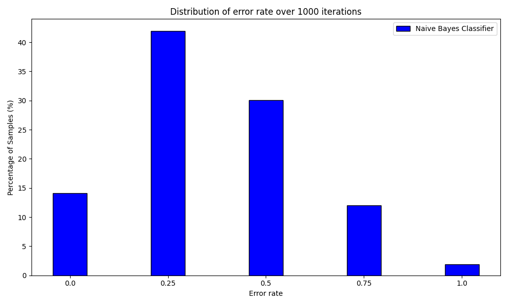
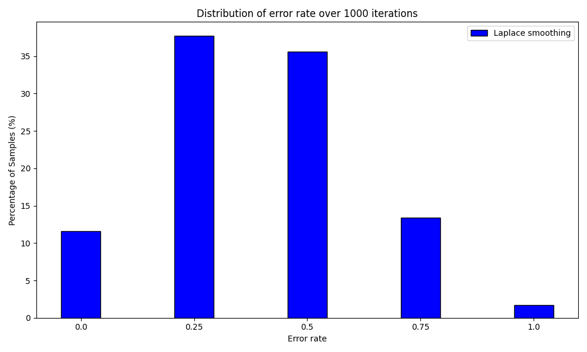

# MachineLearning1-Assignment1
## Categorical Naive Bayes Classification

Educational implementation of a categorical Naive Bayes classification workflow using a weather dataset. The project explores class priors, conditional likelihoods and prediction scores, and compares a baseline implementation with a smoothing variant.

### Experiments

- Load categorical weather records and split them into training and test sets.
- Estimate class priors and feature likelihoods.
- Generate class scores and predictions for the `Play` target.
- Repeat the experiment over 1,000 random splits and visualise error-rate distributions.

### Setup and execution

```bash
git clone https://github.com/MattiaTinfena/MachineLearning1-Assignment1.git
cd MachineLearning1-Assignment1
python3 -m venv .venv
source .venv/bin/activate
python -m pip install numpy pandas matplotlib
python main.py
```

Run from the repository root so `weatherData.txt` can be located. Configure the training-set size, smoothing parameter and repetition count in `main.py`.

### Main files

- `LoadData.py`: parsing and random splitting.
- `computePrior.py`, `computeLikelihood.py`: probability estimation.
- `computeLikelihoodLaplace.py`: smoothing variant.
- `computePosterior.py`: score computation and prediction.
- `printResults.py`: result visualisation.

### Implementation notes

This is coursework code. The current smoothing function adjusts zero counts only, and the prediction selection in `computePosterior.py` uses likelihood products before class-prior multiplication. These details should be considered when interpreting the comparison with textbook Naive Bayes and additive smoothing.

## Example outputs



